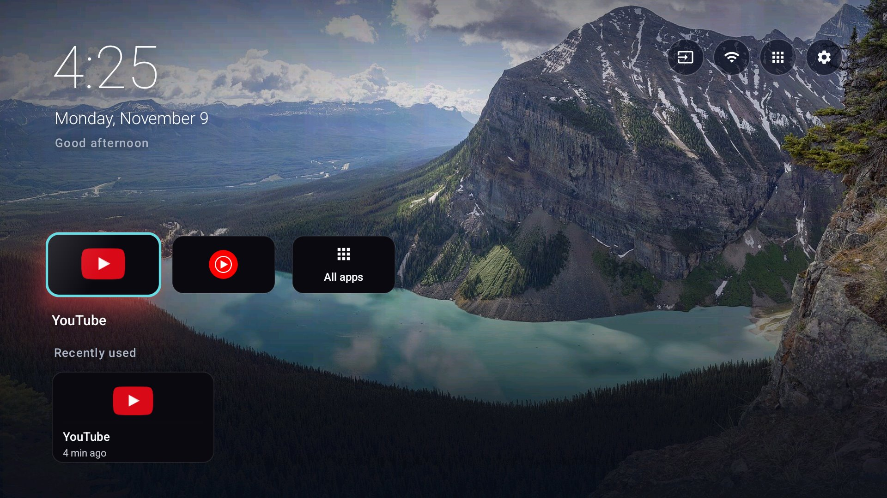
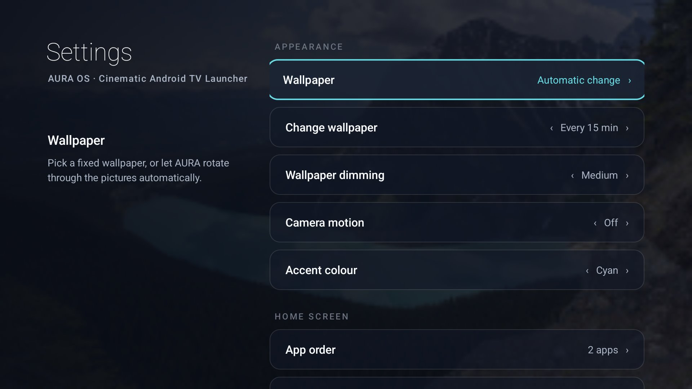
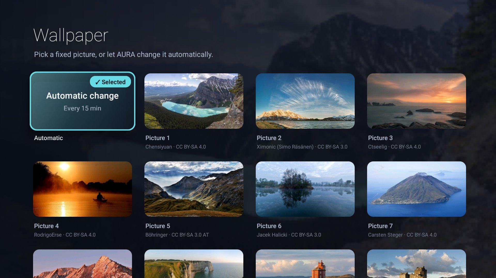

<h1 align="center">AURA OS</h1>
<p align="center"><b>Cinematic Android TV Launcher</b><br><i>Your TV. Your Experience.</i></p>

<p align="center">
  <a href="https://github.com/Saksen2k1/aura-os/releases"></a>
  <a href="https://github.com/Saksen2k1/aura-os/actions/workflows/build.yml"></a>
  
  <a href="LICENSE"></a>
</p>



A lightweight, customizable and cinematic launcher for Android TV and Google TV. Photo wallpapers with a
film-style grade, a clean row of your apps shown as their own colourful logos on dark cards, and a
"Recently used" row. No ads, no tracking, no network access.

## Features

- **Cinematic home screen**: large clock, date and greeting over full-screen photo wallpapers, with a
  darkening grade baked into the picture so text stays readable.
- **Dark app cards with colourful logos**: AURA finds each app's own logo (transparent banner,
  adaptive-icon foreground, or a cleanly cut-out icon) and centres it on a near-black card.
- **One app row** you arrange yourself, plus **All apps** for everything else.
- **Recently used** row from Android's own usage history (optional, stays on the TV).
- **Inputs** (HDMI, AV, Live TV) on TVs that have them; hidden on streaming boxes.
- **Fully D-pad driven**, with a cyan focus frame, smooth scale, soft shadow and a colour glow.
- **Settings on the TV**: wallpaper, automatic change, dimming, camera motion, accent colour, card style,
  card size, app names, app order, usage access and default home app.
- **English and Danish** interface; dates follow the TV's language.
- **Light**: plain Android framework, no libraries, no background services, about 4.7 MB with wallpapers.

| | |
|---|---|
|  |  |

Screenshots are from the Android TV and Google TV emulators, with only the apps that ship in them.

## Supported Android versions

Android TV and Google TV **8.0 (API 26) and newer**. Tested on the Android TV 8.0 and Google TV 14
emulators and on one MediaTek Android TV 11 set; see [Compatibility](#compatibility).

## Installation

1. Download `AURA-OS-v1.1.0-beta.1.apk` from the [latest release](https://github.com/Saksen2k1/aura-os/releases)
   and check its SHA-256 against the release notes.
2. Install it with a file manager on the TV (allow "install unknown apps" for it) or over ADB:
   `adb install AURA-OS-v1.1.0-beta.1.apk`.
3. Open **AURA OS** from the TV's app list. It works as a normal app straight away.
4. To make it the home screen, see [docs/INSTALL.md](docs/INSTALL.md). Many TVs ask you to choose a home
   app; Google TV and some Android TV builds keep their own launcher unless you change it over ADB, and the
   guide shows how to do that and how to undo it.

AURA OS never disables system apps or changes system settings by itself, and needs no root.

## Customization

Everything is in **Settings** on the TV (the gear icon, top right):

| Setting | Options |
|---|---|
| Wallpaper | 12 built-in photos, your own JPG/PNG files, or automatic change |
| Change wallpaper | Off, every 5, 15 or 30 minutes, every hour |
| Wallpaper dimming | Light, Medium, Strong |
| Camera motion | Off (default) or a slow pan across the photo |
| Accent colour | Cyan, Violet, Amber, Rose, White |
| App cards | Dark with logo (default), Glass, Original banner |
| Card size / App names | Normal or Large / on focus or always |
| App order | Pick, move, remove and add apps in the row |
| Recently used, Greeting | On or off |

Your own wallpapers go in `Android/data/io.github.saksen2k1.aura/files/wallpapers/` on the TV; the
Wallpaper screen shows the exact path.

## Build from source

Needs JDK 17 and the Android SDK (build-tools 34.0.0, platform android-34). No Gradle.

```bash
./build.sh            # Linux / macOS, debug APK in dist/
```

```powershell
.\build.ps1           # Windows
```

Release signing, reproducibility and the CI build are described in [docs/BUILD.md](docs/BUILD.md).

## Compatibility

| Device | Android | Status |
|---|---|---|
| Android TV emulator | 8.0 (API 26) | Verified: install, start, all screens, home switch and undo |
| Google TV emulator | 14 (API 34) | Verified: install, start, all screens, home switch and undo |
| MediaTek (m7322) Android TV | 11 | Daily use of AURA OS 1.0, the private build this release grew from; 1.1 beta not yet on hardware |
| TCL, Sony Bravia, Philips, Xiaomi, Hisense, Nvidia Shield, Chromecast with Google TV | 8–14 | Unverified, community testing needed |

Full matrix and how to report a device: [docs/COMPATIBILITY.md](docs/COMPATIBILITY.md).

## Known limitations

- **"Continue watching" with episodes and artwork is not possible** for a sideloaded launcher: Android TV
  only shares that data with system apps. AURA shows the apps you used last instead.
- **Becoming the home screen** may need ADB on Google TV and some Android TV builds (see the install guide).
- The Wi-Fi network name only appears where Android allows it without location access; otherwise AURA
  shows "Wi-Fi connected".
- Camera motion keeps the GPU busy; on slower TVs navigation is smoother with it off (the default).
- Performance numbers so far come from one TV and from emulators; see [docs/PERFORMANCE.md](docs/PERFORMANCE.md).

More help: [docs/TROUBLESHOOTING.md](docs/TROUBLESHOOTING.md).

## Contributing

Bug reports, device reports and pull requests are welcome; read [CONTRIBUTING.md](CONTRIBUTING.md) first.
Security issues: see [SECURITY.md](SECURITY.md).

## License

AURA OS is released under the [MIT licence](LICENSE). It began as a fork of
[tv-home](https://github.com/mihirgupta0900/tv-home) by Mihir Gupta (MIT). The wallpaper photos are
CC BY-SA and credited in [CREDITS.md](CREDITS.md); the Material icons are Apache-2.0. Details in
[THIRD_PARTY_NOTICES.md](THIRD_PARTY_NOTICES.md). App names and logos shown on screen belong to their owners.
